# FREEDOM
**3lb Vertical Spinner Combat Robot**
 
Villanova Combat Robotics | National Havoc Robotics League (NHRL) | Role: Weapon Systems Design Lead

A 3lb vertical spinner built for NHRL, one of the largest combat robotics circuits in the country. FREEDOM was part of Villanova Combat Robotics' first-ever competition cohort and the club's first NHRL appearance.

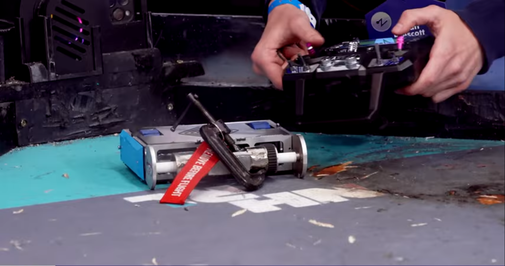

## Status at a Glance

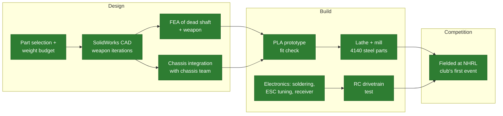

*Full weapon system taken from part selection and CAD through machining, electronics, and competition.*

## Key Results

- **Complete weapon system fielded:** designed, machined, and integrated a belt-driven vertical spinner for the club's first NHRL competition.
- **Dead shaft weapon design:** spinner runs on ball bearings around a stationary 4140 steel dead shaft, with FEA confirming the shaft and weapon could take impact loading.
- **In-house machining:** dead shaft turned and weapon hub milled from 4140 alloy steel on a lathe and mill.
- **Electronics integration:** soldered the power chain, tuned weapon and drive ESCs, mapped receiver channels, and adjusted the throttle curve for drive response.
- **Recovered from a fabrication failure:** when the CNC chuck shattered the night before competition, the team manually machined key weapon features to still field the robot.

## Demo

https://github.com/user-attachments/assets/a1d59dde-191d-4497-a97f-fc3ec471614c

*Drivetrain under remote control. The weapon isn't shown, since no safe testing environment was available before competition.*

## Competition Outcome and Lessons

With the CNC down, key weapon features were machined by hand under time pressure, leaving no window to test the weapon before competition. The manual parts had tolerance and balance error, and at competition RPM the weapon vibrated loose mid-match, eliminating the robot early.

- **Build in schedule margin.** One equipment failure removed all testing time. Machining and assembly need to finish early enough to absorb a setback.
- **Avoid single points of failure in fabrication.** A backup machine, outside shop, or design that tolerates manual machining would have kept one broken part from cascading.
- **Weapon length drove much of the difficulty.** It took a large share of the weight budget, tightening margins everywhere else and likely worsening the tolerance and balance issues.

---

## Background and Role

As Weapon Systems Design Lead, I owned the full weapon system: part selection, SolidWorks design and iteration, lathe and mill machining, and electronics integration. I also supported the wider build: integrating across subsystems, part selection for the platform, chassis design, machining and electronics outside my scope, and tracking weight against the 3lb limit with a shared weight budget spreadsheet. As the club's first competition build, most of the process was worked out as a team in real time.

## Technical Details

### Weapon Design

Weapon iterations focused on damage output, reliability, and weight. I worked closely with the chassis team so the weapon mounted correctly, fit the chassis geometry, and stayed within the weight budget.

*Vertical spinner and dead shaft assembly. Ball bearings and 3D-printed spacers sit on the stationary dead shaft so the spinner can be belt-driven. The shaft mounts to aluminum side walls in the chassis. Simple FEA confirmed the shaft and weapon could withstand impact loading.*

### Chassis

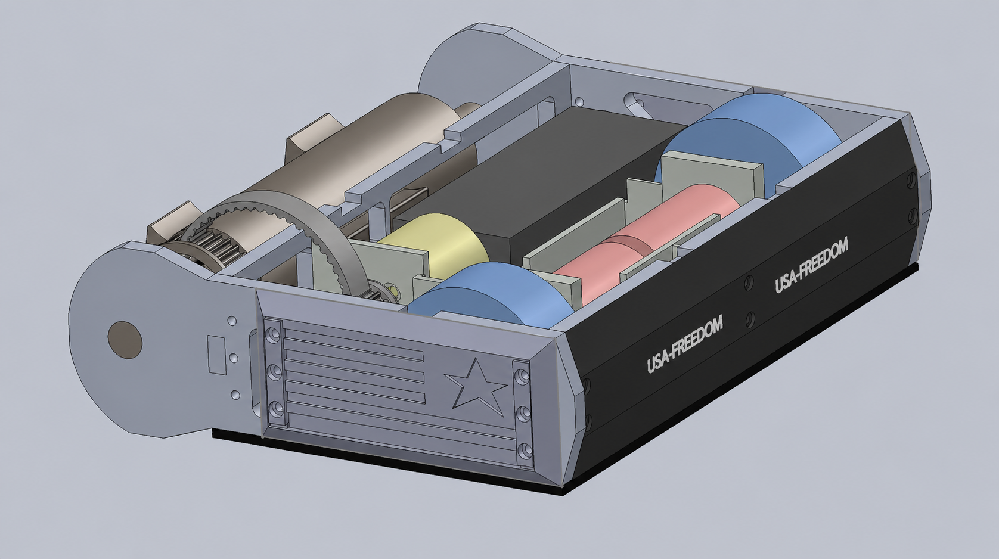

*Chassis built around a low-profile carbon fiber plate to save weight while protecting the drivetrain and electronics.*

### Bill of Materials

| Component | Function | Part | Photo |
|---|---|---|---|
| Weapon Motor | Drives the weapon system | BadAss 2315-1480Kv Brushless Motor | 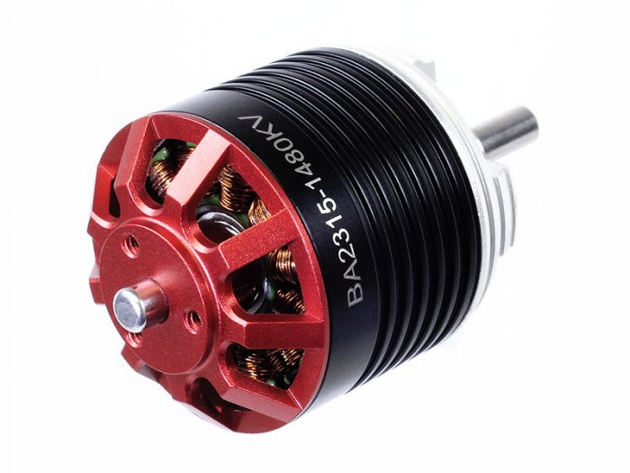 |
| Drive Motor | Powers wheel drivetrain | Max Brushless 2006 Mk2 Beetleweight Planetary Gearmotor | 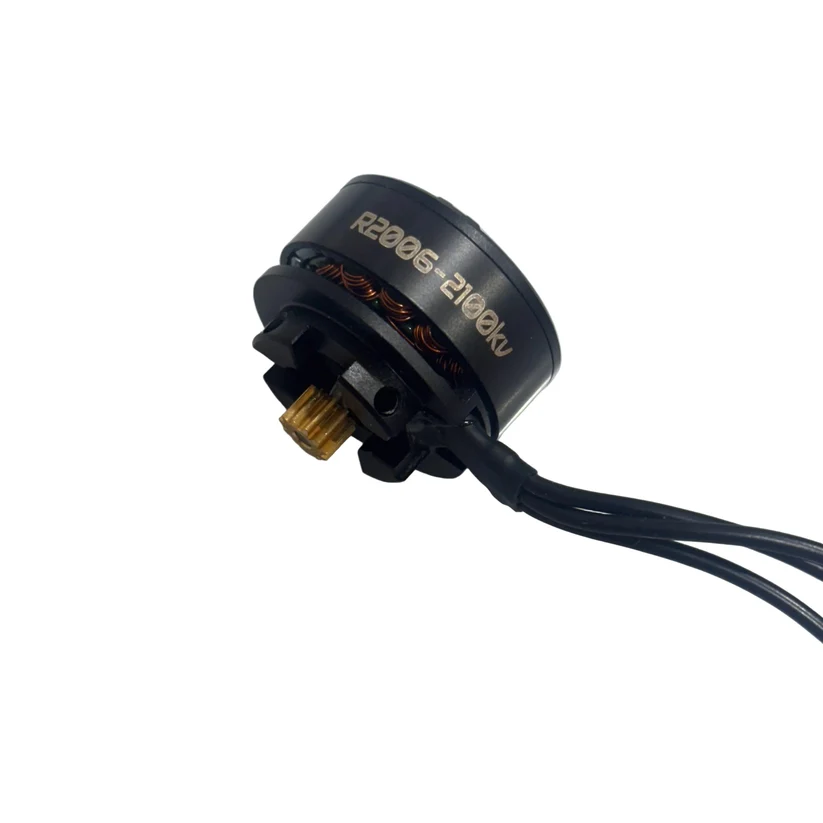 |
| Weapon ESC | Controls weapon motor speed | Vortex 80A ESC (Beetle Weapon / Big Bot Drive) | 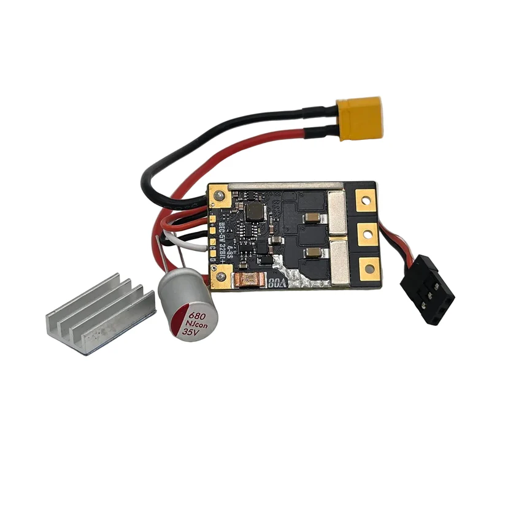 |
| Weapon Metal | Raw stock for weapon fabrication | 2" Alloy Steel Round Bar, 4140 Annealed, Cold Finish | 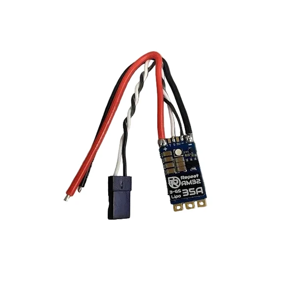 |
| Dead Shaft Metal | Raw stock for dead shaft fabrication | 1/2" Alloy Steel Round Bar, 4140 Annealed, Cold Finish | 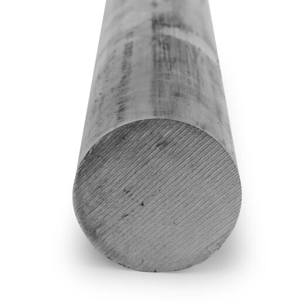 |
| Chassis Material | Lightweight structural plate for chassis | Carbon Fiber Plate | 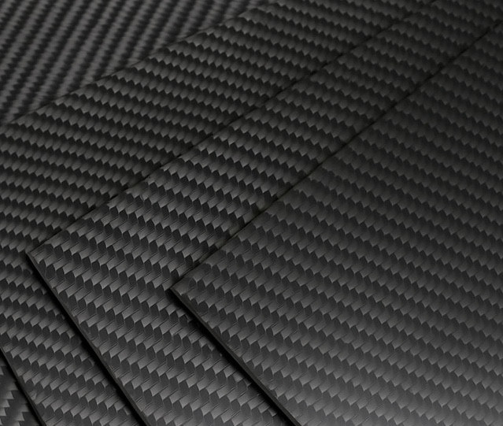 |
| Ball Bearings | Support rotating shafts | TRITAN Radial Ball Bearing 6000, Dbl Sealed, 10 mm Bore, 26 mm OD, 8 mm Wd | 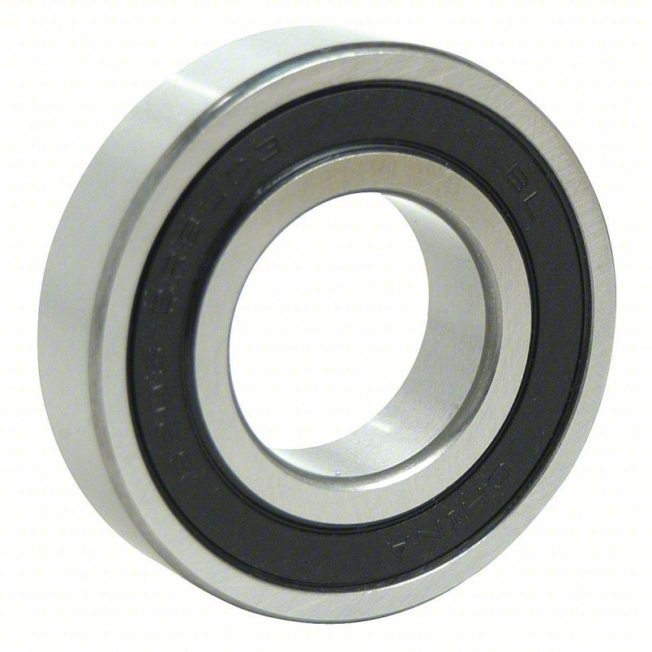 |
| Timing Belt Pulley | Transfers rotational drive to belt | High-Strength GT Timing Belt Pulley, Press-Fit, 9 mm Max Belt Width, 3/16" Shaft, 16T | 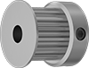 |
| Timing Belt | Transmits drive motor power | High-Strength Ultra-Quiet Timing Belt, Curved Teeth, 9 mm, 165-3P-09, Gates PowerGrip GT | 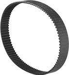 |
| Wheels | Provide traction/mobility | BaneBots Wheel, 2" x 0.8", Hub Mount, 50A, Blue | 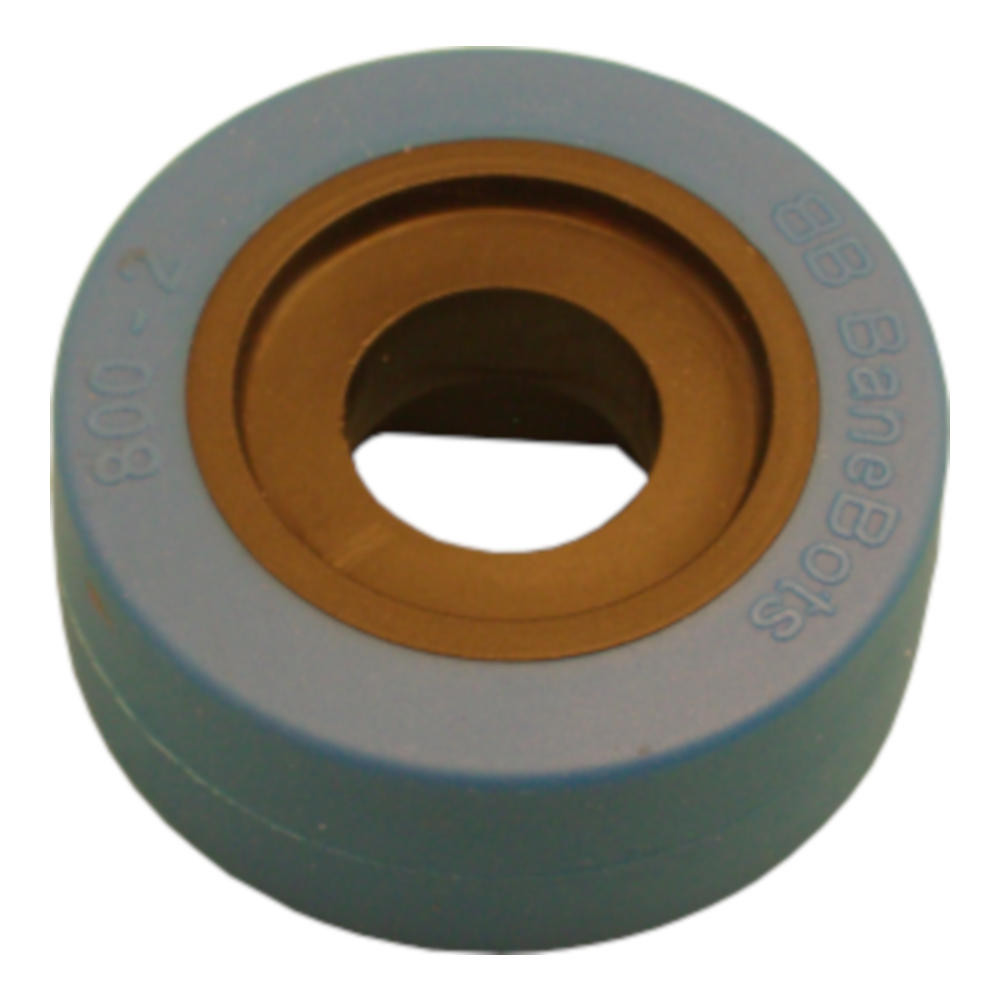 |
| Wheel Hubs | Mount wheels to drive shaft | T81 Hub, 6 mm Shaft | 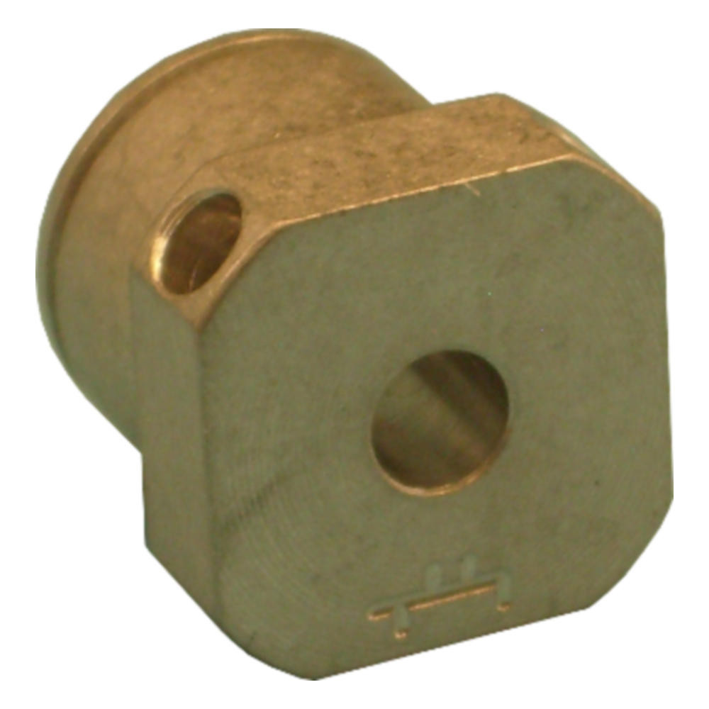 |
| Transmitter | Sends control inputs to robot | FlySky FS-i6 6CH Transmitter | 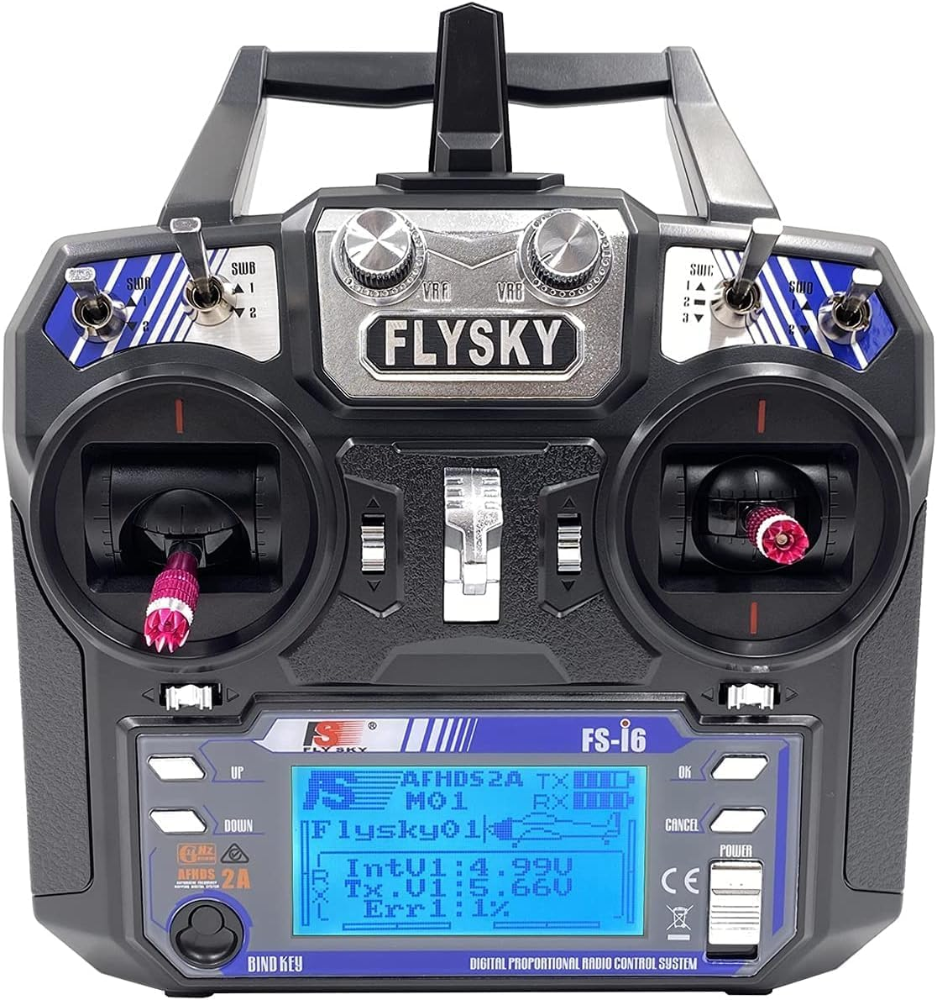 |
| Receiver | Receives transmitter signal, outputs to ESCs | FlySky FS-iA6B 6CH Receiver |  |

---

## Build Log

### Fabrication

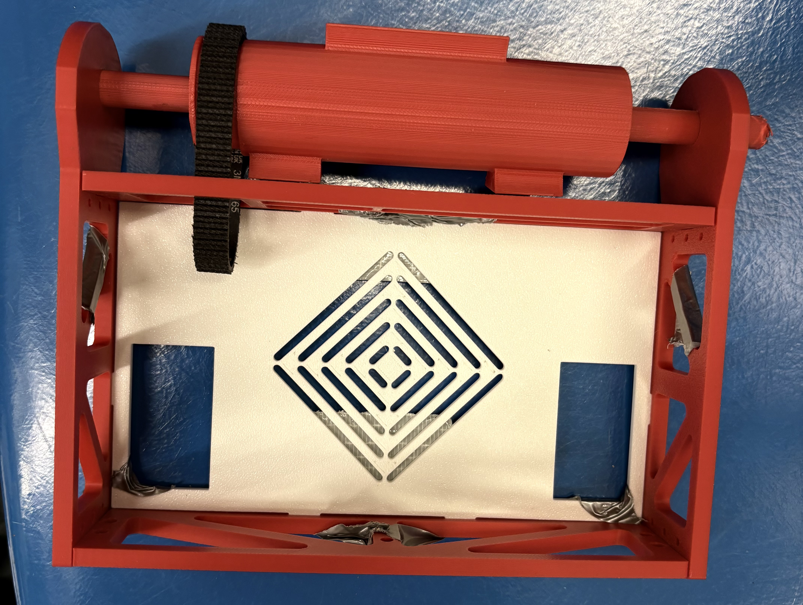

*PLA prototype used to validate the design. Final weapon components were then machined from 4140 alloy steel on a lathe and mill, including turning the dead shaft and milling the weapon hub to final tolerance.*

### Electronics

Electronics was another area where I worked closely with the chassis team, drawing on prior RC experience. Integration covered the full signal and power chain: soldering motor and battery connections, tuning the weapon and drive ESCs for consistent throttle response, mapping controller inputs to the correct receiver channels, and adjusting the throttle curve for competition driving.

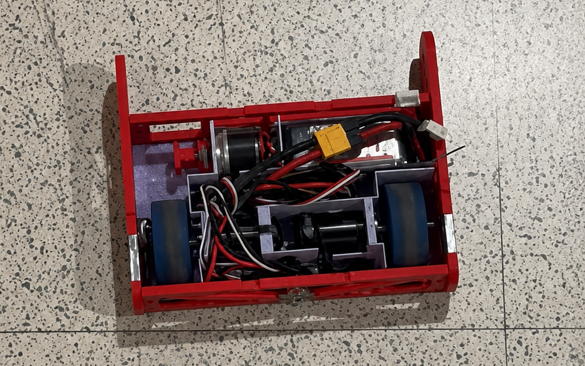

*PLA prototype with electronics installed for a driving test.*

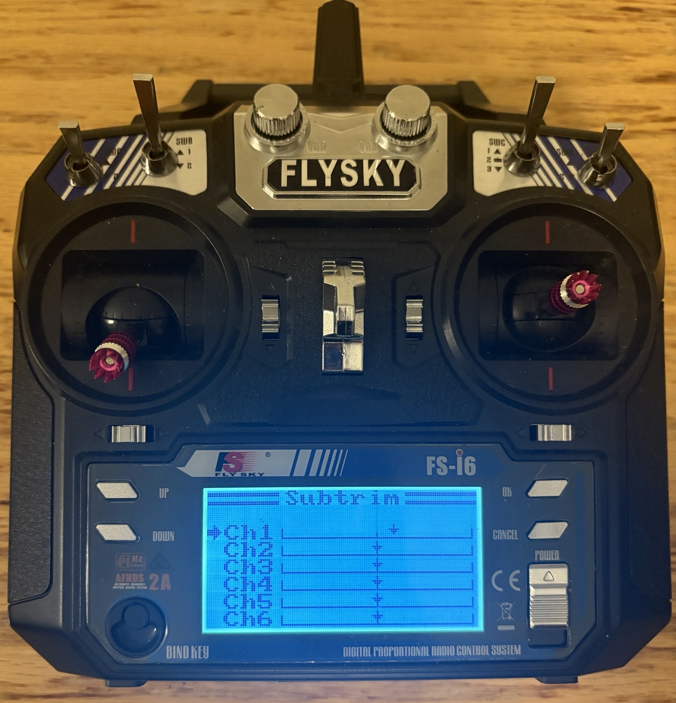

*FlySky transmitter subtrim configuration, used to fine-tune channel centering and drive response before competition.*

### Drive Test

https://github.com/user-attachments/assets/a1d59dde-191d-4497-a97f-fc3ec471614c

*Drivetrain under remote control ahead of competition.*

---

## Next Build

This year I'm engineering lead for the full robot, directing mechanical design and build scheduling across all subsystems while continuing to lead the weapon system. I'm also building a training curriculum for new members covering soldering, SolidWorks, embedded systems, machine shop fabrication (lathe, mill, CNC), and FEA.

- **Shorter weapon:** less weight, moment of inertia, and stress on the mount, easing machining tolerances and structural demands.
- **More robust weapon shape:** tolerant of manual machining error in case CNC access is disrupted again.
- **Schedule margin and equipment contingencies:** so a single failure can't eliminate testing before competition.
